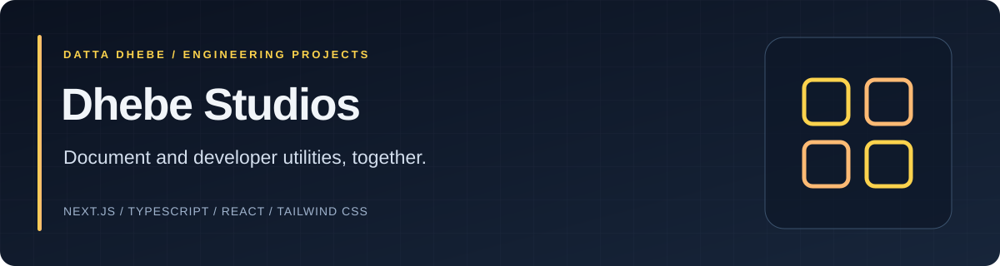
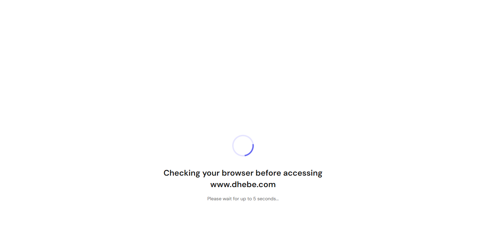

<p align="center">
  
</p>

# Dhebe Studios

**A browser-first workspace for everyday document, image, and developer tasks.**

Dhebe Studios brings PDF workflows, image tools, Base64 utilities, calculators,
and an email designer into one responsive website. Most tools process inputs
locally; conversions that need a server are clearly labeled before upload.

[Explore the website](https://www.dhebe.com) · [Getting started](#getting-started) · [Deployment](PDF_TOOLS_DEPLOYMENT.md) · [Contributing](CONTRIBUTING.md)

[](https://github.com/DattaDhebe/dhebe-studios/actions/workflows/ci.yml)
[](.nvmrc)
[](LICENSE)

## Explore the studios

| Studio | What you can do | Open |
| --- | --- | --- |
| PDF | Merge, split, compress, edit, OCR, and convert documents | [PDF Studio](https://www.dhebe.com/pdf-studio/) |
| Images | Resize, crop, compress, change formats, and remove backgrounds | [Image Studio](https://www.dhebe.com/image-studio/) |
| Base64 | Encode and decode text, files, images, PDFs, and audio | [Base64 Studio](https://www.dhebe.com/base64-studio/) |
| Calculators | Work with dates, percentages, loans, tax, and other calculations | [Calculator Studio](https://www.dhebe.com/calculator-studio/) |
| Email | Design reusable email layouts, preview, undo edits, and export HTML | [Email Studio](https://www.dhebe.com/email-studio/) |
| DhebeVoice | Learn about the Android reader and volunteer for early testing | [DhebeVoice](https://www.dhebe.com/dhebevoice/) |

Shared workspaces include searchable tool navigation, mobile layouts, keyboard
focus support, and light/dark themes. See the [studio guide](STUDIOS_HUB_README.md)
and [PDF feature reference](PDF_TOOLS_FEATURES.md) for scope and limitations.

## Workspace preview



## Getting started

Use **Node.js 24** and **npm 11 or newer**. The repository includes `.nvmrc` and a
committed npm lockfile for reproducible installs.

```bash
git clone https://github.com/DattaDhebe/dhebe-studios.git
cd dhebe-studios
npm ci
npm run dev
```

Open `http://localhost:3000`.

| Command | Purpose |
| --- | --- |
| `npm run dev` | Start the development server |
| `npm run lint` | Check application and script code |
| `npm test` | Run shared-library and static-preview tests |
| `npm run build` | Type-check and generate the static website in `out/` |
| `npm start` or `npm run preview` | Preview the built export at `http://127.0.0.1:3000` |
| `npm run test:browser` | Run Playwright against the built export |

For browser tests, build first and install Chromium once:

```bash
npm run build
npx playwright install chromium
npm run test:browser
```

The local preview serves the frontend only. Server conversions and PHP tester
signup need their separate services; browser regressions mock these requests.
See [contributing](CONTRIBUTING.md) for the full test workflow.

## Processing and privacy

| Layer | Responsibility | Data handling |
| --- | --- | --- |
| Browser | Most PDF, image, Base64, calculator, and email workflows | Inputs remain on the device; email drafts can persist in local browser storage |
| Conversion API | Office imports/exports, PDF/A, repair, encryption, and background removal | Selected files are uploaded; temporary files are deleted after processing, and prepared results expire |
| Premium-hosting PHP | Optional DhebeVoice tester signup | Email, signup time, and consent version are stored privately with 180-day retention |

Server conversions have **25 MB input** and **150 PDF-page** limits. PDF-to-Word
extracts selectable text; it does not reconstruct every layout. PDF-to-PowerPoint
uses page images, and spreadsheet export depends on detectable text or tables.

The tester list is separate from using the Android app. Signup does not send an
invitation automatically. [Storage ownership and exact locations](STORAGE.md)
and the [signup service guide](services/shared-hosting/README.md) explain private
access, retention, and the pending legacy-record reconciliation.

## Architecture

```text
Next.js + React + TypeScript
  -> Static export on Hostinger Premium
     -> Browser-side tool processing
     -> Isolated conversion API on the VPS
     -> Same-origin PHP endpoint for optional tester signup
```

| Location | Responsibility |
| --- | --- |
| `app/` | Routes, page metadata, and global styles |
| `components/` | Studios, shared interface elements, and tool workbenches |
| `lib/` | Tool registries, calculations, processing helpers, and API client |
| `services/tools/` | Containerized conversion service and integration tests |
| `services/shared-hosting/` | Private tester-signup handler and maintenance |
| `scripts/` | Static preview, PDF.js asset synchronization, and deployment helpers |
| `tests/` | Unit, browser, and opt-in live regression checks |

Trading code, trading storage, and shared trading-proxy configuration belong in
the separate `F:\ai_projects\ai-trading` repository, not this one. Preserve the
existing `/trade/`, `/api/`, and other hosted applications during deployment.

## Documentation and support

- [Deployment guide](PDF_TOOLS_DEPLOYMENT.md) covers safe static-file publishing.
- [Storage guide](STORAGE.md) records ownership, database locations, and retention.
- [Conversion service](services/tools/README.md) describes supported formats and limits.
- [Tool audit](TOOL_AUDIT.md) records verified behavior and known limitations.
- [Contribution guide](CONTRIBUTING.md) explains development and pull requests.
- [Security policy](SECURITY.md) explains private vulnerability reporting.

[Report a bug](https://github.com/DattaDhebe/dhebe-studios/issues/new/choose) or
email [support@dhebe.com](mailto:support@dhebe.com). Do not post private documents,
tester addresses, access tokens, or trading data in issues or attachments.

## License

Copyright 2026 Datta Dhebe. This project uses the **custom personal-use and
commercial terms in [LICENSE](LICENSE)**, not the MIT license. Dependency
licenses remain separate. The repository rename does not change existing
attribution or commercial-use requirements.
