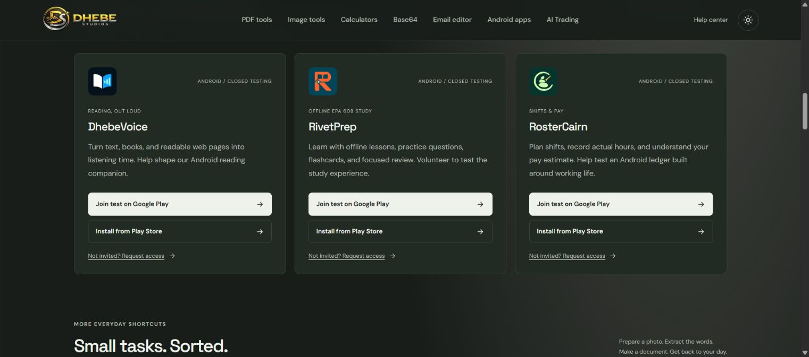

# Android Play testing links - deployment record

Published to **https://www.dhebe.com/** on **24 October 2026 (Asia/Calcutta)** after the owner explicitly approved: "Approve publishing to dhebe.com".

The homepage Android section and DhebeVoice, RivetPrep and RosterCairn landing pages now provide separate **Join test on Google Play** and **Install from Play Store** links. Eligible testers join first with the same Google account used in Play Store; new visitors retain the invitation form. Mobile overview links target the download hero, and invitation links target the signup form. RivetPrep copy reflects 600 EPA questions, 32 EPA lessons and separate introductory regional packs.

## Publication and verification

- Uploaded the approved static overlay through Hostinger File Manager into scoped `public_html`, then extracted into `.` with overwrite enabled. No whole-root replacement or deletion was used; independent app roots and the API were preserved.
- The earlier upload approval block was resolved by explicit owner approval. The denied `private/` staging area was not used.
- Lint, TypeScript/production build, 35 Node tests and 38 browser tests passed. Static audit: 94 canonical pages, 40 permanent aliases, no indexing or internal-link errors.
- Live homepage and three app pages returned HTTPS 200 and matched the final export byte hashes. All 10 referenced JavaScript/CSS URLs returned 200 with correct MIME types; protected app/privacy, Trade and Datta endpoints remained 200.
- Live browser verification confirmed all six homepage Play links; at 390px there was no horizontal overflow and the download controls were at least 44px high.
- Live homepage: 121,174 bytes; SHA-256 `008eecb1bb6261657084afcab0ae7af76b9e36fd19eb71341c33f92ba6fcdfd5`.

## Approved artifacts and rollback

- Overlay: `dhebe-play-links-overlay.zip`, 3,445,456 bytes; 952 changed frontend files / 12,871,789 uncompressed bytes. SHA-256 `a21d384dd3501d7ab1bdb4cc97a913b9a895103f04314807472f041f247960d0`.
- Archive order and every contained hash were verified: assets first, route data next, HTML last, with no enclosing `out/` directory. Backend/private/subdomain paths, credentials and server files were excluded.
- [Approved manifest](assets/android-play-links-manifest-2026-10-24.json) SHA-256: `6bf1167e657423545f2e11acd69bb2943d2a4faaf81b708b57d118360fbf7fed`.
- Artifact directory: `C:\Users\DELL\AppData\Local\Temp\dhebe-play-links-final-rPdvWx`.
- Rollback archive in that directory: `dhebe-play-links-rollback.zip`, 3,402,204 bytes / 946 prior files; SHA-256 `23939b1d0b8ca429ff753e83c1c21fc96099ade51f016499f5df7cfa0a618b7b`.
- Full pre-change export: `C:\Users\DELL\AppData\Local\Temp\dhebe-play-links-before-vpawCM\out`; its sibling `manifest.json` records the baseline. Baseline homepage matched live exactly before editing.
- The public overlay ZIP remains in `public_html`; it contains only the same public frontend files. No cleanup deletion was attempted.

Actual live screenshot SHA-256: `ae6adf23d000e8fdac76e277cf20ecc5e0f8ad4e35d64906aefefebef3785733`.
